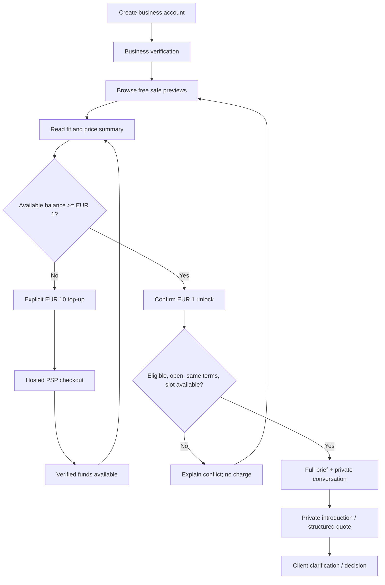

# UX flows and service blueprint

**Intent:** warm craftsmanship outside; a clear, practical workbench inside. Visual tokens are in [DESIGN.md](DESIGN.md).

## 1. Information architecture

| Audience | Primary navigation | Primary action |
|---|---|---|
| Visitor | How it works; For carpenters; Trust; Pricing; Sign in | Post a job |
| Client | My jobs; Conversations; Help; Account | New job |
| Carpenter | Jobs; My conversations; Access balance; Profile; Help | Filter suitable jobs |
| Operator | Job review; Business verification; Cases; Finance; Audit | Work an assigned queue |

Mobile carpenter navigation: Jobs, Conversations, Balance, Profile. Keep Help reachable in two taps. Separate client/professional workspaces and announce role changes; never infer charge authority from the currently visible page.

## 2. Client journey

1. Select a carpentry category; see a realistic example and “not sure” path.
2. Complete a five-step wizard: work/scope → dimensions/materials → photos/access → area/budget/timing → preview and publish. Preserve progress; no mandatory photo upload.
3. Mark unknown dimensions explicitly. Show a simple measuring guide and allow a site-measurement requirement; never imply estimates are structural advice.
4. Verify email and phone and confirm authority to commission the work. Full address is optional and private; city is sufficient for matching.
5. Review the exact carpenter preview, with contact information excluded. Submit for moderation. Show pending, approved or correction-needed status; no false instant-live confirmation.
6. Receive private introductions and offers. Answer a scope question once on the shared board. A private clarification can be rewritten and explicitly published by the client, after checking it contains no commercial/personal information.
7. Compare gross total, material/finish assumptions, exclusions, start range, site visit and validity. A cheaper quote with excluded materials is not visually ranked as the winner.
8. Select one current quote, confirm intent and share contact/address only if desired. Finish the construction agreement/payment directly with the chosen business.
9. Mark complete and review. Business may confirm completion. A client can close without a hire and give a neutral reason.

**Operational handoff:** review queue checks genuine scope, safe preview and scanned attachments. Proposed staffed target: review within one business day, not a 24/7 promise. If no eligible supply exists, show a waitlist/coverage message before publication rather than charging irrelevant businesses.

## 3. Carpenter journey and purchase boundary



The top-up screen says: “Adding funds does not reserve this job. Confirm the €1 unlock when you return.” If the job fills while payment is pending, the balance remains available; offer an unused-funds refund route, not an automatic alternate purchase.

## 4. Core wireframes

### A. Client landing, mobile-first

```text
[HoutMatch]                          [Sign in]
Goed timmerwerk begint met een duidelijke klus.
Describe the work. Compare up to 3 private proposals.
[Plaats gratis je klus]  [Ik ben timmerman]

Cabinets | Doors & trim | Repairs | Wood installations
How it works: brief -> clarify -> compare -> choose
Real consented portfolio examples (no invented testimonials)
Trust, privacy and professional pricing links
```

### B. Carpenter preview (free)

```text
Cabinet installation                            OPEN
Utrecht · approximate distance 5–15 km
Budget EUR 800–1,500 · timing 2–4 weeks
Dimensions supplied: yes · site measurement: requested
Materials: client unsure · client confirmed 8 hours ago
2 of 3 lifetime places used

Unlock full brief and respond: EUR 1.00 incl. VAT
Your balance: EUR 4.00
[Bekijk voor EUR 1,00]    [What do I get?]
Not a guaranteed job. No phone/address shared by payment.
```

Preview contains approved structured data only. Never render a blurred full paragraph or actual job image behind a paywall.

### C. Entitled job workspace, desktop

```text
Jobs / Cabinet installation            [Report] [Status]
+---------------------------+------------------------------+
| Versioned brief           | Private conversation         |
| Measurements + photos     | Client and YOUR business     |
| Budget + timing           | Messages / quote versions    |
| Scope Q&A (shared)        | [Send proposal]              |
| Non-commercial only       | [Request site visit]         |
+---------------------------+------------------------------+
Access receipt: EUR 1.00 · terms v1 · [View policy]
```

Mobile uses labeled tabs: Brief, Shared scope Q&A, Private conversation. Every composer permanently identifies its audience. Do not make “shared/private” a small icon toggle in one composer.

### D. Client quote comparison

Three consistent offer cards, then a comparison table on desktop. Mobile lets users pin two offers and compare rows; do not shrink a three-column table into unreadable text. Show “estimate pending site visit” prominently. Unknown items display “not provided,” never zero.

## 5. Critical interaction states

| State | Required content/action |
|---|---|
| Verification pending/failed | Reason or expected next step; no paid CTA; appeal link |
| Empty job feed | Show active filters and coverage; do not invent availability; broaden radius with consent |
| Slot filled between preview and purchase | Conflict explanation; no debit; preserve filters |
| Balance insufficient | Explicit top-up amount and terms; return to preview, not automatic spend |
| Payment pending | Honest pending state; polling status; safe exit; no credited balance yet |
| Duplicate tap / timeout | Disable during request; retry with same idempotency key; retrieve receipt |
| Job material edit | Revision notice, difference summary and quote refresh requirement |
| Job cancelled/expired | Read-only badge; applicable restoration status; no paid CTA |
| No client response | Deadline and objective eligibility; show pending/restored state without implying no-award compensation |
| Moderation hold / blocked participant | Stop unsafe actions, provide case link; do not reveal reporter identity |
| Upload failed or quarantined | Preserve form/message draft; show retry/remove; do not send an unreadable attachment silently |
| Network lost | Keep an unsent message in current-view memory only while it survives; no false “sent” or automatic resend; explain that reload/OS termination loses unsaved text; wipe on logout; server-saved job drafts resume online |
| Retention deletion | Tombstone with minimal receipt; no dangling download links |

## 6. Dutch microcopy examples

- Client CTA: **Plaats gratis je klus**.
- Carpenter unlock: **Bekijk voor €1,00 incl. btw**.
- Confirmation: **Je betaalt één keer voor deze klus. Je kunt daarna de volledige klus bekijken en reageren. Dit is geen garantie op de opdracht.**
- Shared audience: **Zichtbaar voor de opdrachtgever en alle ontgrendelde timmerbedrijven. Deel hier geen contactgegevens of prijzen.**
- Private audience: **Alleen zichtbaar voor jou en de opdrachtgever.**
- Filled thread: **Deze klus heeft al drie bedrijven. Er is niets afgeschreven.**
- Restoration: **€1,00 teruggezet op je toegangstegoed. Bekijk de reden en je overzicht.**
- Contact disclosure: **Deel mijn adres alleen met dit bedrijf**; unchecked by default.

Dutch copy needs native-speaker review before launch. Use locale-aware EUR formatting, metric dimensions and Europe/Amsterdam display times; store timestamps in UTC.

## 7. Service blueprint and recovery

| Moment | User-visible service | Backstage responsibility | Recovery |
|---|---|---|---|
| Submit brief | Pending review with case reference | Trust checks preview and scope; worker scans media | Request a correction; no sale until ready |
| Buy access funds | Hosted checkout; pending/paid | Billing verifies PSP state and grants once | Poll/reconcile; never trust redirect alone |
| Unlock job | Receipt and actual content | Transaction commits debit, entitlement, slot and outbox together | Replay result after timeout; rollback all on failure |
| Ask/respond | Clear shared/private audience | Server enforces membership; worker delivers generic notification | Persist message before notifying; draft recovery |
| Invalid/no-response job | Eligibility and restoration reason | Policy worker/operator; audited ledger reversal | Appeal, no direct balance editing |
| Account closure | Export/delete timeline and funds resolution | Privacy + finance separate content from required records | Resolve cash refund; apply minimal legal hold where justified |

## 8. Prototype validation

Test the free/paid boundary, €10 top-up versus €1 price comprehension, shared versus private audience, slot-race failure and quote comparison with at least five participants on mobile. Include one keyboard-only and one screen-reader session. Record tasks completed, misunderstandings and time, not a visual preference vote. No live payment is required for prototype testing.

## 9. Desktop and installed-mobile experience

Use the same account and server-side jobs/balance across desktop, Android and iPhone; switching devices does not purchase access again. Installation is an optional convenience after the user has seen value, not an onboarding/paywall requirement. Android shows the browser-supported installation action when available, otherwise instructions. iPhone provides Safari Share → Add to Home Screen guidance, following [Apple's installation instructions](https://support.apple.com/guide/iphone/open-as-web-app-iphea86e5236/ios); do not present a non-working universal install prompt.

Standalone mobile views need visible back/home navigation, safe-area padding, a keyboard-safe composer, readable €1/€10 disclosures and ordinary file/photo selection. Camera capture is optional; denied permission still allows file selection. HEIC/HEIF photos need a supported safe conversion path or a clear JPEG/PNG alternative before upload; never silently attach an unsupported file.

On app switch/resume, refresh job status, balance and conversation permissions before enabling actions. Checkout may return from a bank app to a browser rather than the installed window; recover the owned pending payment through authenticated server status, with reauthentication if needed. Never infer payment success from where the window opened.

Offline view explains that private jobs/messages/payments are unavailable without connectivity. Keep only unsent in-memory text when possible; no promise of durable offline drafts or background send. After reconnection show current state and require a fresh intentional action; resolve ambiguous previous operations first. A waiting update prompts a reload after unsaved work is saved online or explicitly discarded, never during checkout. Full support/recovery rules are in [Cross-platform delivery](14-cross-platform-and-pwa.md).
