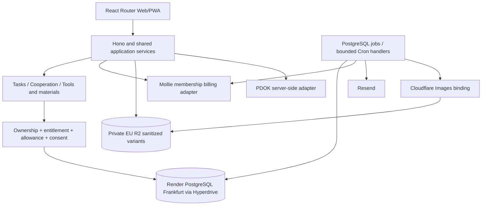

# Architecture design
**Version:** 0.4 · **Updated:** 22 October 2026

## 1. Modular monolith, three domain boards
Keep one TypeScript application with internal modules and shared PostgreSQL transactions. Web/PWA requests and bounded job handlers share authorization, membership and allowance services. The scope expands beyond the old single client-task board; it does not require domain microservices or a separate database per board.

## 2. Module boundaries
| Module | Owns |
|---|---|
| Identity/companies | Guest task authority, company/ZZP accounts, staff MFA and organization-scoped permissions |
| Information catalog | Board type, publisher, safe preview, lifecycle/visibility and board-specific detail routing |
| Tasks/offers | Client briefs, private offers, scope revisions, callback consent, close/reopen/withdrawal |
| Cooperation | Company work packages, independent project references and private interest |
| Trade | Tools/material descriptions, condition/quantity/price/area, inquiry and availability |
| Plans/access | Current membership entitlement, approved monthly counting policy, atomic/idempotent detail access |
| Billing | Low-price subscription payments/periods/refunds/reconciliation only; no per-offer charge or publication-payment dependency |
| Matching/notifications | Board/category/region/radius filters, explicit opt-in, no full-detail or consent bypass |
| Privacy/operations | Rights, erasure, reports/holds, minimal audit and billing/quota exceptions |

## 3. Preserved selected stack
| Component | Selection and qualification boundary |
|---|---|
| Web/API | React Router framework mode + React/Vite/SSR; TypeScript/Hono on Cloudflare Workers |
| Database | Paid Render PostgreSQL Frankfurt through Hyperdrive; application query caching disabled; external TLS endpoint and reviewed source-IP access |
| Database tooling | Drizzle ORM + node-postgres (pg), reviewed SQL migrations; explicit locks/constraints and transaction-scoped connections |
| Identity | Better Auth, company verified-email/password; staff invite-only password/TOTP/one-use recovery; guest task access independent |
| Payments | Mollie only; requalify new subscription terms/mandates and event association; no Stripe evaluation |
| Mail/jobs | Resend with dedicated subdomain; durable PostgreSQL inbox/outbox/jobs and bounded Cron, initially one-minute recovery poll with optional post-commit immediate attempts |
| Photos | Private EU R2 + Images Workers binding; sanitized variants and live authorized reads; metadata/HEIC/runtime/privacy evidence required |
| Location | Minimum server-side PDOK queries and local approximate matching |

## 4. Atomic boundaries
The allowance policy is a new business invariant. Resolve visibility first, then transact plan/period evaluation, unique company-item access and quota update; never allow two parallel sixth accesses. All detail, media/contact and notification paths need consistent access decisions. Quota proposals are not yet approved commercial terms.

Billing observations activate only the correct company/period after authenticated provider verification. Creating or cancelling a provider subscription is not proof of settled funds or the complete application entitlement. Keep financial effects unique and reconcile ambiguous outcomes without blind retries.

No external provider call is made while holding a domain lock. Request/Cron handlers share the same claims. Optional request wake-up is not durable storage. Privileged migrations are separate from request/job startup.

## 5. Budget and privacy
Retain the €100/month ex-VAT infrastructure planning budget; qualify the expanded workload and exact plans before claiming capacity. Human work, domains, legal/accounting, payment fees/reserve, ads and future AI hosting are separate.

GDPR applies to every board. Parent-project links do not transfer private data rights. EU R2/Render placement does not establish all processing/logging/support locations; retain Resend US and Images processing/retention review. New-board geography, expiry, trading/payment boundary and quota/billing terms need policy before live activation.

See [technical design](05-technical-design.md), [data model](06-data-model.md), [v0.4 redesign](22-platform-redesign.md) and the [historical deployment comparison](18-cloudflare-vs-render.md).
