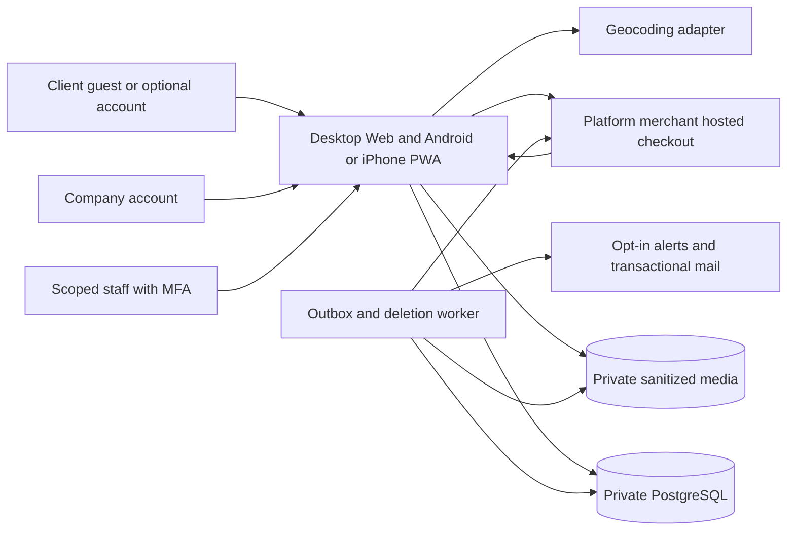

# Architecture design
**Version:** 0.3 · **Updated:** 21 October 2026

## 1. Small information platform, shared Web/PWA
Use a TypeScript modular monolith: Next.js responsive Web/PWA UI and server API, PostgreSQL, private EU photo storage and one restartable background worker. All three user surfaces share server-owned identity, task, offer and fee records. No native app build, distributed microservices, wallet service, construction-payment service or work-monitoring system.

Construction visits, negotiations, final contracts and payments are direct between parties outside the system. An offer list is not a booking, guarantee or verified completion record.

## 2. Modules
| Module | Owns | Boundary |
|---|---|---|
| Identity | Company accounts, optional client accounts, guest job sessions | Email ownership/session security, not quality certification |
| Tasks | Lightweight briefs, region, material revision, close/delete deadline | Safe company projection; no rival-response metadata |
| Companies | Declared profile, contacts, categories, radius, alert preferences | Details are self-declared unless a specific legal check says otherwise |
| Responses | One company/task record, rough offer, client-private list | Own-only company reads; no public bidder feed |
| Fee billing | €1 intent, PSP verification, publication/refund effects, accounting | No client charge or contractor payouts; no mandatory prepaid balance |
| Matching/alerts | Provider adapter, approximate radius/category, email deduplication | Consent and live eligibility rechecked at dispatch |
| Privacy/operations | Contact permissions, reports, access holds, deletion, minimal audit | No construction supervision or routine workmanship checking |

Keep API adapters separate from server-side domain services so future native clients can reuse rules; no premature native auth/store receipt endpoints.

## 3. Provider choices
| Component | Recommendation / approval needed |
|---|---|
| Web/PWA | Next.js/React/TypeScript, manifest, static-only offline fallback |
| Database | Managed PostgreSQL; explicit locks and reviewed migrations |
| Payment | Hosted PSP such as Mollie, platform legal entity as merchant and approved business settlement account |
| Location | PDOK Location API candidate for low-cash-cost Dutch matching; Google Geocoding optional with budget/licensing/privacy review |
| Email | Transactional provider with authenticated sending domain, opt-in preferences, bounces/unsubscribe and processor review |
| Photos | Private EU object buckets, real-type checks, metadata stripping and safe variants |
| Auth | Maintained session/magic-link/OIDC implementation; no homegrown password/token crypto |
| Worker | PostgreSQL inbox/outbox and leased jobs; no separate message broker initially |

Pin maintained supported versions at implementation. No providers, accounts or billing projects are provisioned by this documentation.

## 4. Critical atomic boundaries
- Guest token exchange: consume token once and create job-scoped session.
- First response publication: verified payment observation + job eligibility/revision + visible response + retained successful-fee uniqueness + accounting/outbox.
- Close/contact change: job state/consent version + audit + cancellation of eligible future sends; existing private offer list stays scoped.
- Refund: unique amount reservation/reference before provider call; confirm provider result before marking complete.
- Deletion: time-gated authorization first, idempotent relational/object purge and tombstone progress; fee ledger remains content-minimal.

No external PSP/geocoding/email call while holding a job transaction lock. No client redirect, email link, phone permission or PWA cache decides that money is paid.

## 5. Privacy boundaries
Company task reads are free but authenticated and allowlisted: safe description, approved photos, category, city/PC4 and approximate distance. Full client postcode/contact is separate. Only the client job session sees the full response list; a company never gets rival offers/counts through SQL, DTOs, pagination or analytics.

Photos/downloads remain private, no-store and time-limited to the earlier of authorization expiry or task delete_at. No live job SEO index. Service worker caches only approved public static assets and a non-personal offline page; private pages/API/media/payment states remain network-only.

## 6. Deployment/recovery
Single EU primary region, separate web/worker processes from one revision, private PostgreSQL with PITR, isolated staging/test PSP and mail. Confirm subprocessors/support/backup regions; “EU server” alone does not resolve transfers.

Pilot targets: RPO <=1h and RTO <=4h, proven in a restore drill. After restore, apply deletion tombstones and reconcile all PSP activity since backup before serving/purchasing. App rollback must not roll back financial facts. Worker outage never permits expired task access; payment outage never grants an unpaid offer.

Use backward-compatible migrations and retain compatible old public PWA assets during updates. See [Technical design](05-technical-design.md), [PWA](14-cross-platform-and-pwa.md) and [tests](11-test-and-launch-plan.md).
