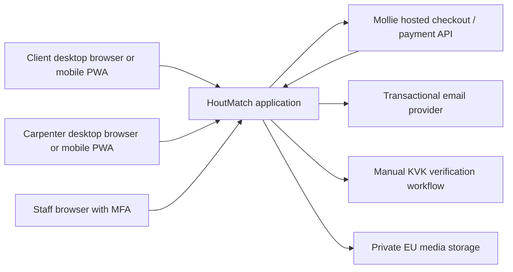
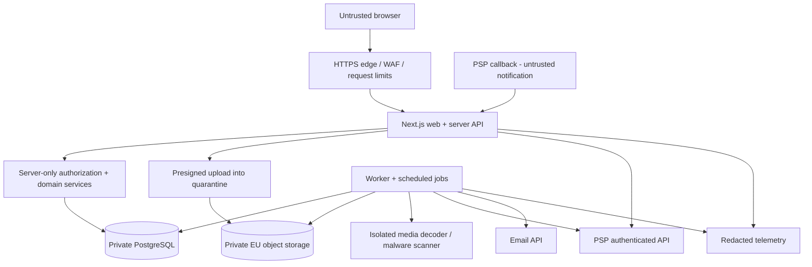

# Architecture design

**Status:** proposed architecture · **Scale assumption:** local pilot, 100 concurrent active users, 10,000 retained jobs

## 1. Architectural choice

Use a **TypeScript modular monolith**: one Next.js responsive Web/PWA UI for desktop, Android and iPhone, a shared server API, PostgreSQL as transactional authority, and one background worker using the same domain modules. A manifest and narrowly scoped service worker provide installation and a public offline fallback, not offline private-data access. Private EU object storage holds scanned media; a PSP handles hosted checkout for platform access only. Use managed operations where practical.

The business problem needs strong consistency across price, balance, lifetime capacity and entitlement. One database transaction is simpler than distributed billing/messaging services. No Kubernetes, Kafka, vector search, separate search engine or native mobile app in MVP.

## 2. System context

Construction agreement and construction payments remain between client and carpenter outside this system. The platform is the merchant for its own access service; no professional payouts or split payments are designed.

## 3. Containers and trust boundaries

- Browser state is not trusted for identity, price, balance, scope, verification or object access.
- PSP callback data is a notification, not financial proof; fetch the stored payment using the authenticated PSP API.
- All database access is server-only. Browser clients never receive database service credentials or query raw tables.
- Only public marketing assets use a shared CDN cache. Authenticated job/message/billing responses are private and non-cacheable.
- Job media is private; every read is authorized. Download links are short-lived bearer capabilities, never public storage URLs.

## 4. Modules and ownership

| Module | Owns | Allowed collaboration |
|---|---|---|
| Identity | Users, role grants, sessions, verification | Exposes current principal and verified business identity |
| Jobs | Drafts, revisions, lifecycle, safe previews, lifetime slot counter | Entitlements locks a job through its domain interface |
| Discovery | Category/radius/date filters, matching explanation | Reads safe projections only; never reads private chat |
| Billing | Top-ups, source lots, journal, refunds, reconciliation | Grants spendable balance only after verification |
| Entitlements | One business–job purchase, charge terms and access status | Coordinates job + wallet transaction |
| Conversations | Private messages and shared scope Q&A | Authorizes through jobs and entitlement policy |
| Offers | Immutable quote versions, selection and completion | Uses job revision and private-channel membership |
| Trust | Reports, holds, verification cases, reviews and appeals | Privileged actions require scoped roles/case audit |
| Operations | Outbox processing, notifications, retention jobs and metrics | Consumes events after the source transaction commits |

Modules are boundaries in one deployable codebase, not network services. The entitlements use case may share a database transaction across billing and jobs deliberately. Avoid an ORM hook that debits money as an accidental side effect of reading a thread.

## 5. Main consistency boundaries

| Operation | Atomic local writes | External work |
|---|---|---|
| Publish job | Approved revision, safe projection, state, expiry, audit, outbox | Email notification after commit |
| Unlock | Debit allocations + balanced journal, entitlement, lifetime slot, idempotency result, outbox | None inside transaction |
| Credit top-up | Verified provider observation, lot grant, journal, top-up state, outbox | PSP verification before transaction |
| Select quote | Winner, job state/version, audit, notification outbox | Email after commit |
| Restore access fee | Unique restoration, credit-source restoration, journal, entitlement read-only, audit | Cash refund only through a separate PSP workflow |

Do not claim exactly-once webhook delivery. Deliver events at least once and enforce deduplicated business effects.

## 6. Suggested implementation stack

| Layer | Proposal | Reason / alternative |
|---|---|---|
| UI + API | Next.js App Router, React, TypeScript; Web manifest and public-static-only service worker | One desktop/Android/iPhone Web/PWA codebase; platform APIs progressively enhance ordinary browser functionality |
| Persistence | Managed PostgreSQL, SQL migrations, Drizzle or equivalent typed query layer | Must support explicit transactions/row locks and reviewed SQL |
| Validation/contracts | Shared schema validation and generated OpenAPI in implementation | DTO allowlists; no database entity serialization |
| Authentication | Maintained OIDC/auth library or managed EU-capable identity provider | Shortlist during G0; no custom password cryptography |
| Worker | Same Node runtime/domain package; PostgreSQL outbox/leased jobs | No extra broker until throughput proves need |
| Checkout | Mollie hosted checkout; initially approved local bank method | Local-market fit; actual merchant approval required |
| Storage | EU-region S3-compatible private buckets | Vendor/region/DPA chosen at G0 |
| Testing | Unit runner; real PostgreSQL integration tests; Playwright; accessibility checks | Core financial tests must not rely on mocked locks |

Pin supported stable releases and an active Node LTS at implementation kickoff; record exact versions and licenses then. No dependency installation or provider provisioning is part of this delivery.

## 7. Deployment and operations

Proposed topology: single EU production region; web and worker as separate processes/containers built from one revision; private managed PostgreSQL with PITR; EU object buckets; restricted staff/admin endpoint. Staging is isolated with PSP test credentials and synthetic data. CI builds and tests; deployment requires approval and migration review.

EU primary hosting does not alone settle international data transfers. Review subprocessors, support access, email delivery, telemetry and backup regions in the processor register before contracting.

Readiness checks database connectivity and required migrations; liveness avoids dependency-induced restart loops. Database loss fails closed for paid/read-private operations. PSP outage disables new top-ups but already-funded internal unlocks may continue if reconciliation and fraud controls are healthy. Email outage delays notifications, not committed messages.

Deploy backward-compatible expand/backfill/contract migrations. Retain previous runtime for application rollback; never “roll back” financial history by restoring an old database over new payments. Restore drills reconcile all PSP activity after the restored database point before reenabling purchases.

## 8. Growth and cost triggers

- Start with PostgreSQL filtering on category/city/date. Coarse city-distance matching avoids collecting precise coordinates.
- Add PostGIS only after a measured need for more precise service areas and privacy review.
- Consider dedicated job queue/search only if p95 budgets fail after query/index optimization or measured worker lag exceeds five minutes under expected load.
- Split a module into a service only for independently necessary scaling/compliance/team ownership, not hypothetical traffic.
- Initial infrastructure budget assumption €150–400/month, excluding staff, acquisition, verification labor and PSP fees. Obtain vendor quotes before approval; this is not a sourced price promise.

Technical invariants and protocols are in [Technical design](05-technical-design.md); ADRs and unresolved vendor choices are in [Decisions](12-decisions-and-risks.md).

## 9. PWA now, dedicated mobile clients later

The user confirmed Web/PWA-first delivery. Android and iPhone are MVP platforms, not merely future native-app targets. All three surfaces use the same backend authority and policy; installation must not introduce another balance or entitlement store. See [Cross-platform delivery](14-cross-platform-and-pwa.md) for the versioned support matrix, cache allowlist, checkout recovery and maturity gate.

The service worker is browser-side delivery infrastructure, separate from the server-side outbox worker. It cannot decide entitlement, replay financial writes or cache private render/API/media responses. Hosting must serve the worker script revalidatably and retain compatible versioned public assets long enough for old installed clients to reload safely.

Keep API adapters separate from server domain services so future dedicated clients can reuse policy/data contracts. Native UI, device authentication, app-store payments/review, native push and release pipelines require a later design and budget; neither a wrapper nor a framework selection is authorized by this phase.
