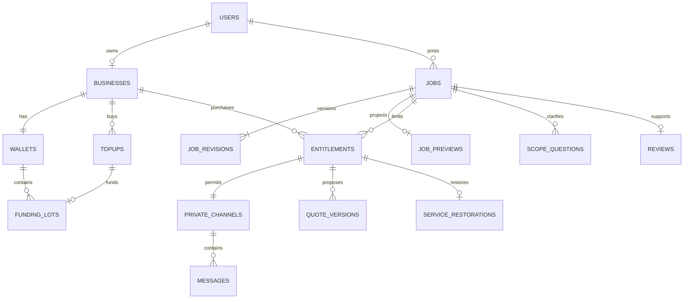

# Data model and persistence design

**Status:** logical schema plus selected constraint sketches, not executable migrations. All identifiers are UUIDs unless stated; all timestamps are UTC `timestamptz`; monetary values are integer EUR gross cents.

## 1. Relationships



An entitlement exists even after its access is read-only or revoked. Billing records retain opaque references after content deletion; do not cascade-delete journal history with a job/account.

## 2. Core entities

| Table | Essential fields / constraints |
|---|---|
| `users` | auth subject UNIQUE, email/phone verification times, locale, status, deletion state; no raw password material if OIDC is used |
| `businesses` | owner_user_id UNIQUE for MVP, KVK number UNIQUE, legal/display name, service city, categories, availability range, verification state/date, suspension/payment holds |
| `verification_cases` | business, check type/result/date, checker, evidence pointer, reason, review due; sensitive raw evidence separated and minimized |
| `jobs` | client_user_id, category, lifecycle, current_revision_id, version, lifetime_slots_used 0..3, first_published_at, expires_at, confirmed_at, awarded_business_id, selected_quote_id |
| `job_revisions` | job, revision number UNIQUE per job, structured measurements/materials/finish/unknown flags, description, budget/date range, site access, created_by/time; immutable |
| `job_private_details` | job UNIQUE, optional encrypted address/contact fields and exact location if ever collected; separate access path |
| `job_previews` | job UNIQUE, source revision, approved title, city, safe budget/date ranges, category, completion flags, reviewer/time; never arbitrary raw description or media URLs |
| `entitlements` | job + business UNIQUE for life, amount_gross_cents=100 for P1, currency EUR, price/policy/revision snapshots, status, purchased_at, first_private_response_at, first_client_reply_at, restoration deadline |
| `private_channels` | entitlement UNIQUE; client identity derived from job; no independently supplied client/business membership arrays |
| `messages` | channel, sender_user_id, sender_business_id if applicable, client_message_id, text, created_at, moderation state; UNIQUE(channel, sender, client_message_id) |
| `scope_questions` | job, author, text, answer, source revision, visibility/moderation state; distinct from private messages |
| `quote_versions` | entitlement, logical quote ID, version, job_revision_id, line items, calculated net/tax/gross totals, VAT mode, assumptions/exclusions, visit requirement, start range, valid_until, status |
| `contact_grants` | job, business, client, fields allowed, granted/revoked times; UNIQUE active scope; not implied by payment |
| `attachments` | immutable storage key, uploader, exactly one parent relation, real MIME/bytes/pixel or page counts, scan state, sanitized variant key, deletion status |
| `reviews` | job UNIQUE, client, awarded business, rating/comment, completion evidence label, published_at, business reply, moderation state |
| `reports` / `support_cases` | reporter, typed target, category, evidence refs, assigned operator, outcome, appeal linkage |

MVP profile portfolio items use separately consented, scanned public images; job media is not made public when added to a portfolio.

## 3. Financial and operational entities

| Table | Essential fields / constraints |
|---|---|
| `wallets` | business UNIQUE, available_gross_cents >=0, reserved_refund_cents >=0, disputed_hold_cents >=0, version; materialized projection checked against lots/journal |
| `topups` | business, gross=1000, currency EUR, intent status, PSP/environment/merchant reference, provider_payment_id UNIQUE if known, credited_at, billing snapshot/document reference |
| `payment_attempts` | top-up intent, stable attempt token UNIQUE, PSP request reference, request hash, outcome; prevents recreating ambiguous external calls |
| `funding_lots` | topup UNIQUE, wallet, granted/available/reserved/disputed/refunded/reversed/net_consumed gross cents; source provenance; all components nonnegative |
| `journal_transactions` | business reference type/ID UNIQUE, currency, timestamp, actor/system reason, original transaction reference for reversals |
| `journal_entries` | journal transaction, account code, debit_cents or credit_cents, optional wallet/lot; each entry has exactly one positive side |
| `spend_allocations` | entitlement, funding lot, amount; UNIQUE(entitlement, lot); originals immutable, reversals recorded separately |
| `service_restorations` | entitlement UNIQUE, reason_code, original journal, reverse journal UNIQUE, policy version, evaluated facts, actor/time |
| `cash_refunds` | source topup, refund intent/attempt key UNIQUE, amount, reservation reference, PSP refund ID UNIQUE, state, processed time |
| `payment_disputes` | PSP dispute reference UNIQUE, topup, exposure, resolution, debt amount, frozen value; no silently negative wallet |
| `provider_observations` | provider payment/refund/dispute ID, observed state, time, verification result; no callback-body status as authority |
| `idempotency_records` | actor + operation + key UNIQUE, canonical request hash, status, receipt/resource ID; no cached private response body |
| `outbox` / `consumer_receipts` | event/lease/retry fields; UNIQUE(consumer, event) deduplicates effects |
| `audit_events` | immutable actor, action, target IDs, reason/case, time, correlation ID; no message/body snapshots by default |

**Lot equation:** `granted = available + reserved_refund + disputed_hold + net_consumed + cash_refunded + payment_reversed`. A restoration reduces `net_consumed` and increases available or disputed-held value; no second grant. Reversal classification prevents counting the same principal in both cash-refunded and payment-reversed buckets. PSP chargebacks on already-consumed value create a separate debt/exposure record; they do not subtract that spent amount from availability again.

## 4. Selected SQL constraint sketches

```sql
-- Illustrative fragments only; real migrations must define all foreign keys.
ALTER TABLE jobs
  ADD CONSTRAINT job_lifetime_capacity
  CHECK (lifetime_slots_used BETWEEN 0 AND 3);

CREATE UNIQUE INDEX one_entitlement_per_business_job
  ON entitlements (job_id, business_id);

CREATE UNIQUE INDEX one_provider_payment
  ON topups (provider, environment, provider_payment_id)
  WHERE provider_payment_id IS NOT NULL;

CREATE UNIQUE INDEX one_restoration_per_entitlement
  ON service_restorations (entitlement_id);

CREATE UNIQUE INDEX one_journal_business_effect
  ON journal_transactions (reference_type, reference_id);
```

A CHECK on the job counter alone cannot prove a counter equals actual entitlement count. All insert paths must hold the job row lock and update the counter in the same transaction. Daily reconciliation asserts counter/count equality and <=3. Ban direct manual entitlement inserts in operational tooling.

Journal balance is a multi-row invariant; enforce through the single posting service plus a deferred constraint trigger or reviewed stored procedure and integration tests. Database permissions deny update/delete of posted journal entries; corrections append compensating transactions. Do not describe a simple per-row CHECK as enforcing the total ledger balance.

## 5. Index and query design

- Partial discovery index on OPEN jobs by category, approved city/service area and publication time; filter expiry/client-confirmation in the query too. Join only the safe preview projection.
- `entitlements(business_id, purchased_at DESC)`; unique `(job_id,business_id)` supports authorization.
- `messages(channel_id, created_at, id)` for stable cursor pagination; same pattern for scope questions and journal history.
- `funding_lots(wallet_id, created_at, id)` for FIFO allocation; composite index on unresolved refund/payment status.
- Outbox partial index on unpublished due items; support case status/assignment indexes.
- Query plans verified with realistic test data. Avoid full-text indexing private chats or raw client addresses in the discovery path.

## 6. Deletion and retention separation

Suggested content default: drafts deleted after 90 days inactivity; private job/conversation media and contact grants deleted 12 months after terminal state; sanitized security logs 90 days; backups expire within 35 days. These are **proposed business defaults**, subject to legal purpose review, not statutory periods. Finance documents follow the accountant-approved statutory schedule separately.

Export is scoped to the requester: their own submitted data and permitted conversation records, with third-party data reviewed/redacted; a carpenter never exports another carpenter's quotes. Content erasure tombstones job/channel links and removes media and contact data without deleting minimal lawful financial records. Legal holds require purpose, authorization, review date and restricted access; no indefinite catch-all retention.

## 7. Migration/versioning policy

Use forward-only reviewed migrations and immutable policy/price snapshots. Model terms, price and job revision IDs independently. Stage column additions before deploying writers, backfill with bounded batches, then enforce constraints. A schema rollout must not drop or reinterpret financial provenance. Backup restoration must replay/reconcile PSP activity before enabling purchase writes.
