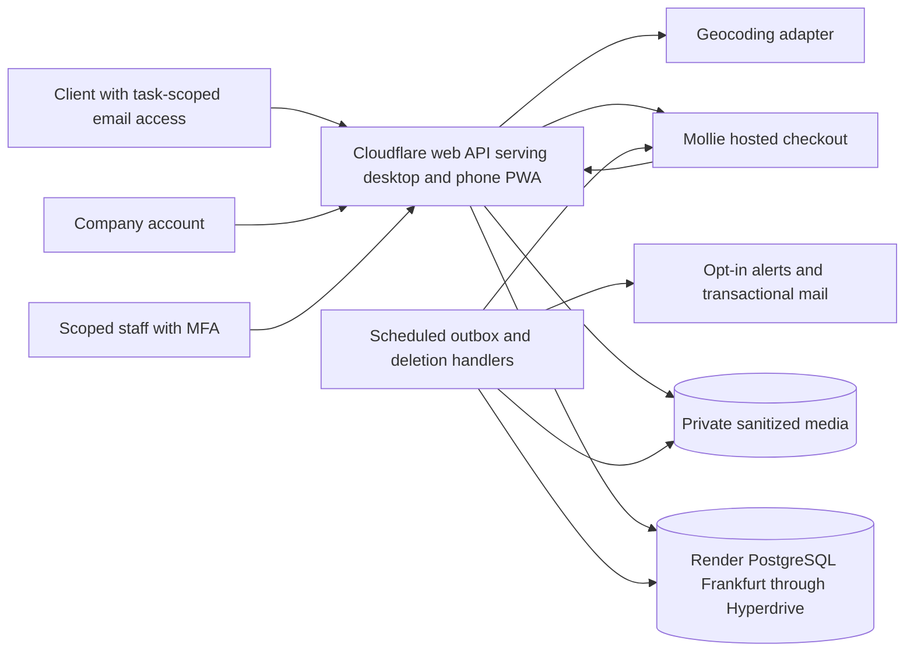

# Architecture design
**Version:** 0.3 · **Updated:** 22 October 2026

## 1. Small information platform, shared Web/PWA
Proposed application shape: a TypeScript modular monolith with responsive Web/PWA UI and server API, PostgreSQL, private EU photo storage and durable background work. The founder requests Cloudflare app hosting; qualify the frontend rendering/build integration and scheduled background handlers before finalizing implementation. All three user surfaces share server-owned identity, task, offer and fee records. No native app build, distributed microservices, wallet service, construction-payment service or work-monitoring system.

After considering FastAPI/Python, Go and Rust/Tokio, the founder delegated the TypeScript-versus-FastAPI choice for performance/latency/concurrency and subsequently explicitly confirmed TypeScript. Hono is now confirmed for the backend HTTP API on Workers; see [ADR 0008](../docs/adr/0008-use-typescript-for-cloudflare-backend.md) and [the assessment](19-backend-options.md). Expected runtime overhead and shared tooling inform this choice; no project throughput/latency benchmark has run. React Router framework mode with React/Vite/SSR is confirmed for the frontend; exact dependency versions remain open.

Here, modular monolith means one application codebase with internal domain modules and shared database transactions. For the proposed Cloudflare layout, request and scheduled handlers share those modules; PostgreSQL runs as a separate managed service accessed with server-only credentials. The earlier persistent web/worker process layout is retained below as the Render comparison. Domain modules do not each receive an independent service or database. Cloudflare is the requested app host; TypeScript/Hono and React Router framework choices are confirmed, while runtime integration and exact background-job limits/configuration remain qualification work; PostgreSQL-backed jobs with Cloudflare Cron are confirmed.

Construction visits, negotiations, final contracts and payments are direct between parties outside the system. An offer list is not a booking, guarantee or verified completion record.

## 2. Modules
| Module | Owns | Boundary |
|---|---|---|
| Identity | Company/staff accounts and guest task sessions | Email ownership/session security; client accounts/linking deferred until after MVP |
| Tasks | Lightweight briefs, region, material revision, close/delete deadline | Safe company projection; no rival-response metadata |
| Companies | Declared profile, contacts, categories, radius, alert preferences | Details are self-declared unless a specific legal check says otherwise |
| Responses | One company/task record, rough offer, client-private list | Own-only company reads; no public bidder feed |
| Fee billing | Individual hosted €1 collection, PSP verification, publication/refund effects, accounting | No client charge or contractor payouts; prepaid bundles/wallets/subscriptions deferred until after MVP |
| Matching/alerts | Provider adapter, approximate radius/category, email deduplication | Consent and live eligibility rechecked at dispatch |
| Privacy/operations | Contact permissions, reports, access holds, deletion, minimal audit | No construction supervision or routine workmanship checking |

Keep API adapters separate from server-side domain services so future native clients can reuse rules; no premature native auth/store receipt endpoints.

## 3. Provider choices
| Component | Recommendation / approval needed |
|---|---|
| Web/PWA | Confirmed React Router framework mode with React/Vite/SSR on Cloudflare Workers; qualify rendering/build, manifest and static-only offline fallback |
| Backend | Confirmed TypeScript and Hono HTTP API on Cloudflare Workers; exact version/dependencies and real-route performance still to qualify |
| Database | Confirmed paid Render PostgreSQL, Frankfurt; Hyperdrive with query caching disabled, external TLS endpoint and reviewed source-IP restrictions; exact plan/version and runtime connection still to qualify; explicit locks and reviewed migrations |
| Database access | Confirmed Drizzle ORM with node-postgres (pg), TypeScript schema and reviewed SQL migrations; retain explicit transaction-scoped SQL/locks and database constraints for critical effects; exact versions and Workers/Better Auth integration remain qualification work |
| Payment | Confirmed: Mollie-hosted checkout through a server-only Payments API adapter; platform legal operator is merchant with approved business settlement account |
| Location | Confirmed PDOK Location API through a server-only adapter with minimum postcode/city queries; approximate radius matching in PostgreSQL/application services; qualify dataset/CRS/terms/limits and pilot-region accuracy |
| Email | Confirmed Resend through a direct platform adapter with application-specific sending credentials and a dedicated sending subdomain; exact domain/address, plan, outbox/event integration and US account-data review remain work; [ADR 0012](../docs/adr/0012-use-resend-for-platform-email.md) |
| Photos | Confirmed private Cloudflare R2 with explicit EU jurisdiction and authorized Worker reads; public bucket access disabled; qualify real-type checks, metadata stripping, safe variants and complete erasure |
| Image processing | Confirmed Cloudflare Images Workers binding for upload-time conversion of JPEG/PNG/WebP/iPhone HEIC inputs; persist sanitized JPEG/WebP variants in private EU R2; metadata, runtime, budget and NFR-09 processing/retention/transfer qualification remain work |
| Auth | Confirmed Better Auth for company/staff accounts with records in Render PostgreSQL; company verified-email/password and invite-only staff password/TOTP/recovery-code policies confirmed; Workers/Hyperdrive/MFA integration still to qualify; guest task-scoped links remain separate |
| Worker | Confirmed PostgreSQL inbox/outbox and leased jobs with bounded Cloudflare Cron handlers; initial one-minute recovery poll and optional bounded immediate attempts only after durable commit; scheduling/backlog delay remains possible |

Hono owns API routing and HTTP middleware; shared application services own authorization, task/offer rules and Mollie effects. UI server loaders/actions must use those same authorization-checked services rather than duplicate business rules. Exact validation/auth/SQL packages and versions remain open.

The founder confirmed React Router framework mode with React, Vite and server rendering; see [ADR 0010](../docs/adr/0010-use-react-router-for-web-pwa.md). Cloudflare documents a [Workers deployment path](https://developers.cloudflare.com/workers/framework-guides/web-apps/react-router/). Its current Vite integration does not support framework SPA mode or prerendering; qualify the proposed SSR path with Hono API routing, asset delivery, cookies, private-response controls and scheduled handlers. Next.js remains a considered alternative, not a selected requirement.

Better Auth is confirmed for company/staff accounts with records in Render PostgreSQL; see [ADR 0011](../docs/adr/0011-use-better-auth-for-company-and-staff-accounts.md): its [Hono integration](https://better-auth.com/docs/integrations/hono), [PostgreSQL adapter](https://better-auth.com/docs/adapters/postgresql) and [2FA plugin](https://better-auth.com/docs/plugins/2fa) fit the intended boundaries. Qualify the exact Workers compatibility flags, database adapter through Hyperdrive, cryptographic operations, session revocation, SSR cookies and required staff MFA across sign-in/recovery paths. Library support for 2FA does not itself enforce staff policy. Guest task-scoped email links must not create client accounts or grant access through company/staff identity; company sign-in is confirmed as verified email plus password, including verification and password recovery; staff invite-only email/password with mandatory authenticator-app TOTP and one-use recovery codes is confirmed, preserving MFA through password recovery; Resend is the confirmed email provider with a dedicated sending subdomain; exact domain/address, versions and operating recovery procedures remain open.

Mollie is the sole provider selected for this stage; see [ADR 0007](../docs/adr/0007-use-mollie-for-current-payment-integration.md). The platform sells its own response-publication service, so it needs no contractor onboarding to payment accounts, connected-merchant routing, construction payouts, subscriptions or wallet. Keep a small server-side adapter for payment creation/retrieval, refunds and reconciliation. Use classic payment-ID notifications with authenticated retrieval, not an assumed signed-event contract. Provider setup and live merchant/method approval remain launch work; no second provider integration or fallback evaluation is planned for this stage.

Pin maintained supported versions at implementation. No providers, accounts or billing projects are provisioned by this documentation.

## 4. Critical atomic boundaries
- Guest token exchange: consume token once and create job-scoped session.
- First response publication: verified payment observation + job eligibility/revision + visible response + retained successful-fee uniqueness + accounting/outbox.
- Close/contact change: job state/consent version + audit + cancellation of eligible future sends; existing private offer list stays scoped.
- Refund: unique amount reservation/reference before provider call; confirm provider result before marking complete.
- Deletion: time-gated authorization first, idempotent relational/object purge and tombstone progress; fee ledger remains content-minimal.

No external PSP/geocoding/email call while holding a job transaction lock. No client redirect, email link, phone permission or PWA cache decides that money is paid.

## 5. Privacy boundaries
Company task reads are free but authenticated and allowlisted: safe description, approved photos, category, city/PC4 and approximate distance. Full client postcode/contact is separate. Only the client job session sees the full response list; a company never gets rival offers/counts through SQL, DTOs, pagination or analytics.

Photos/downloads remain private, no-store and time-limited to the earlier of authorization expiry or task delete_at. No live job SEO index. Service worker caches only approved public static assets and a non-personal offline page; private pages/API/media/payment states remain network-only.

## 6. Deployment/recovery
Cloudflare is the requested application host and paid Render PostgreSQL in Frankfurt is the confirmed database choice; see [ADR 0009](../docs/adr/0009-use-render-postgresql-in-frankfurt.md). Request/scheduled Workers handlers share one codebase and access the database through Hyperdrive; private EU R2 media and the Cloudflare Images Workers binding are confirmed; exact configuration and isolated staging/test PSP and mail remain deployment work. See [Cloudflare versus Render](18-cloudflare-vs-render.md) for compatibility, background execution, caching, network, residency and cost differences. EU primary storage and processor/transfer review remain requirements; global Workers execution is a separate processing boundary.

### Selected database connection

Hyperdrive uses Render's external database hostname with TLS and server-only credentials. Restrict the external access list to the reviewed Cloudflare source ranges and separately authorized migration/administration access; do not retain Render's default all-IP rule or disable the endpoint needed by Hyperdrive. The Render private URL is for same-region Render services and is not directly available to Workers. Sources: [Render connection and access controls](https://render.com/docs/postgresql-creating-connecting), [Hyperdrive source ranges](https://developers.cloudflare.com/hyperdrive/configuration/firewall-and-networking-configuration/). Prove connectivity, explicit transactions and current-state reads with query caching disabled before selecting exact driver versions.

### Render app-hosting comparison baseline — not selected

The earlier Render recommendation was one Frankfurt web service for Next.js, one continuously running background worker from the same repository/revision, and separate paid Render Postgres. It is now the comparison baseline, not the requested app-hosting direction. Render lists [Frankfurt, Germany](https://render.com/docs/regions) as a deployment region and supports [same-workspace, same-region private networking](https://render.com/docs/private-network). Its [background workers](https://render.com/docs/background-workers) can poll the PostgreSQL queue.

| Component | Proposed deployment | Connection |
|---|---|---|
| Next.js web/API | Render web service, Frankfurt | Public HTTPS for users/Mollie notifications; private database URL |
| Background worker | Render background worker, Frankfurt, same codebase | Private database URL; outbound Mollie/mail/media requests |
| PostgreSQL | Separate paid Render Postgres service, Frankfurt | Private database endpoint for authorized application processes; disable external database access |

Render recommends [placing the database in the same region as connecting services](https://render.com/docs/postgresql-creating-connecting). Paid instances provide [continuous backups and point-in-time recovery](https://render.com/docs/postgresql-backups); the documented recovery window is three days on Hobby workspaces and seven days on Pro or higher, not a proven application RPO/RTO. Review actual costs, external-access controls, processor/backup locations, backup expiry and deletion-safe restoration against the existing requirements before selecting a plan or enabling paid beta. No account, database or service has been provisioned. The architecture decision and hosting-provider decision remain separate.

### Supabase option — not selected

Supabase is a compatible managed PostgreSQL option for the same modular application, using its specific [Frankfurt region, `eu-central-1`](https://supabase.com/docs/guides/platform/regions). The current Cloudflare connection proposal uses Hyperdrive; see [the comparison](18-cloudflare-vs-render.md). The earlier Render-plus-Supabase example below describes a persistent backend, not the requested Workers runtime. Supabase Auth and Storage remain optional and do not change guest ownership, company/staff permissions or task erasure.

Keep domain authorization and Mollie publication/refund transactions in the application backend/worker. Use bounded server-side PostgreSQL connections; Supabase documents [direct connections for persistent backends and session pooling when IPv4 is needed](https://supabase.com/docs/guides/database/connecting-to-postgres). This provider choice does not move billing rules into browser writes or require splitting domain modules into services.

| Consideration | Supabase candidate assessment |
|---|---|
| Networking | Render's same-provider private network does not automatically extend to Supabase. A default cross-provider layout uses TLS connections and database IP restrictions; it requires an explicit connectivity decision in place of the earlier colocated private-endpoint proposal. |
| Recovery budget | Pro starts at $25/month with daily backups. The existing <=1h recovery-point target needs finer protection than daily backups; PITR starts at about $100/month extra and requires at least Small compute. This is not a complete deployment quote. |
| Optional bundled services | Auth/private Storage may reduce the number of integrations if selected; their suitability, permissions, delivery and erasure still need validation. Web/worker hosting remains separate in this proposal. |

Sources checked 22 October 2026: [network restrictions](https://supabase.com/docs/guides/platform/network-restrictions), [pricing](https://supabase.com/pricing) and [backups/PITR prerequisites](https://supabase.com/docs/guides/platform/backups). Database IP restrictions cover PostgreSQL/poolers, not Auth, Storage or the HTTPS Data API; those need their own access policies, and unused database APIs should be disabled or restricted. Database backups include Storage metadata, not photo objects, so optional Supabase Storage needs a separate object recovery/erasure design. Supabase remains an unselected comparison alternative; nothing has been provisioned.

### Recovery qualification

Pilot targets: RPO <=1h and RTO <=4h, proven in a restore drill. After restore, apply deletion tombstones and reconcile all PSP activity since backup before serving/purchasing. App rollback must not roll back financial facts. Worker outage never permits expired task access; payment outage never grants an unpaid offer.

Use backward-compatible migrations and retain compatible old public PWA assets during updates. See [Technical design](05-technical-design.md), [PWA](14-cross-platform-and-pwa.md) and [tests](11-test-and-launch-plan.md).
